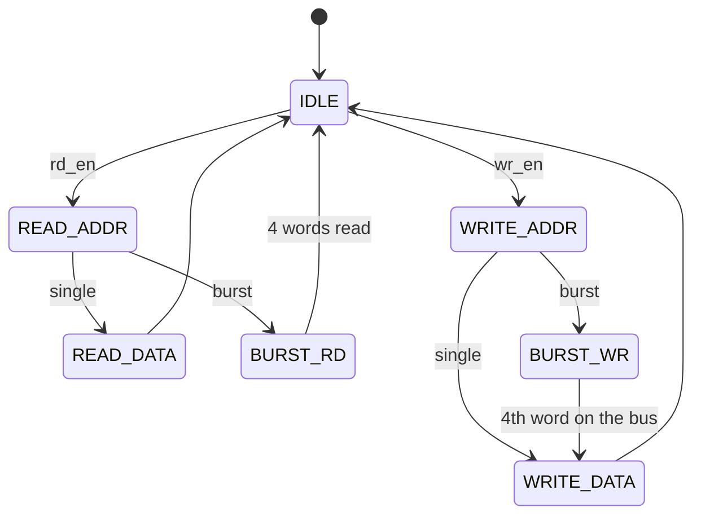

# ZBT SRAM controller in VHDL

A VHDL controller for the Micron MT55L512Y36F, a 512K × 36 ZBT (zero bus turnaround) synchronous SRAM with flow-through outputs. It reads and writes single words or bursts of four, and drives the 36-bit bidirectional data bus through Xilinx IOBUF primitives. It targets a Zynq-7000 (XC7Z007S) in Vivado 2019.1 and is simulated against Micron's VHDL model of the memory. A System on Chip course project at Polytech Dijon (2025–2026).

## The controller

`sram_ctrl3`, in [sram_iobuff.vhd](Control_SRAM.srcs/sources_1/new/sram_iobuff.vhd), is the final version.

| Port | Direction | Role |
|---|---|---|
| `clk`, `reset` | in | Clock and synchronous reset |
| `rd_en`, `wr_en` | in | Start a read or a write; a read wins if both are set |
| `burst_en` | in | Make the read or write a burst of four words |
| `addr_i` | in | 19-bit word address |
| `wdata_i`, `rdata_o` | in, out | Word to write, word read |
| `wdata_burst_i`, `rdata_burst_o` | in, out | Four words to write, four words read; word 0 in bits 35–0 |
| `DQ`, `Addr`, `nADVLD`, `nRW`, `nOE`, `nCE`, `nCE2`, `CE2`, `nCKE` | to the SRAM | Data bus, address and control pins |

The SRAM takes a command at the clock after the controller sets it. Since its outputs are flow-through, it takes write data one clock after the write command and gives read data one clock after the read command. In a burst, ADV/LD# high makes it step through the next addresses, wrapping inside the block of four (linear burst order). Between operations the controller deselects it (CE# high, ADV/LD# low). It can take a new request three clocks after a single read or write, and six clocks after a burst.

The controller has no ports for the byte write enables, the sleep mode and the burst order: the testbenches tie them off, so all four bytes are written and bursts are linear.

## Files

The project went through several controllers before `sram_ctrl3`. They stay in the project, disabled, as the report shows each one.

| File | Content |
|---|---|
| [sram_iobuff.vhd](Control_SRAM.srcs/sources_1/new/sram_iobuff.vhd) | `sram_ctrl3`: the final controller, with IOBUFs and bursts |
| [sram_ctrl.vhd](Control_SRAM.srcs/sources_1/new/sram_ctrl.vhd) | `sram_ctrl1`: a first FSM that writes four fixed words and reads them back |
| [sram_m_controller.vhd](Control_SRAM.srcs/sources_1/new/sram_m_controller.vhd) | `sram_ctrl2`: the commands and data come from outside |
| [sranControler.vhd](Control_SRAM.srcs/sources_1/new/sranControler.vhd), [IO_Buffer.vhd](Control_SRAM.srcs/sources_1/new/IO_Buffer.vhd), [BasculeFF.vhd](BasculeFF.vhd) | Other attempts with IOBUFs |
| [mt55l512y36f.vhd](mt55l512y36f.vhd) | Micron's model of the SRAM |
| [tb_sram_ctrl3_check.vhd](Control_SRAM.srcs/sim_1/new/tb_sram_ctrl3_check.vhd) | Self-checking test of `sram_ctrl3` with the model |
| [SIM.vhd](Control_SRAM.srcs/sim_1/new/SIM.vhd) | `tb_sram_ctrl3`: a write, a read, a burst write and a burst read, to watch in the waveform |
| [tb_test_sram.vhd](tb_test_sram.vhd) | Drives the SRAM model directly: four writes, four reads |
| [tb_test_io.vhd](tb_test_io.vhd) | Unit test of the IOBUF |
| [tb_sram_ctrl.vhd](Control_SRAM.srcs/sim_1/new/tb_sram_ctrl.vhd), [IO_SRAM_tb.vhd](Control_SRAM.srcs/sim_1/new/IO_SRAM_tb.vhd), [IO_SRAM_T.vhd](Control_SRAM.srcs/sim_1/new/IO_SRAM_T.vhd) | Testbenches of the earlier controllers |

## Simulation

1. Open `Control_SRAM.xpr` in Vivado 2019.1 or later.
2. Run the behavioural simulation. Its top is `tb_sram_ctrl3`, shown with `IO_SRAM_tb_behav.wcfg`.
3. For the checks, set `tb_sram_ctrl3_check` as the simulation top and run all. It reports each word read and ends with `end of test, 0 error(s)`.

The Micron model checks setup and hold times. In a behavioural simulation the IOBUFs switch the data bus exactly on the clock edge, so the model reports hold errors on DQ; they do not change what is written or read.

## Fixes since the report

The report's burst waveforms come from an earlier version of `sram_ctrl3`, which had three faults:

- When idle, it kept the SRAM selected with ADV/LD# high. That continues the last burst, so after a write the SRAM went on writing the released bus into the next addresses, and a word written a few clocks earlier was lost.
- A burst read took the first word one clock before the SRAM put it on the bus.
- A burst write released the bus before the fourth word.

`tb_sram_ctrl3_check` failed every check on that version and passes on this one. It was run with the open-source simulator nvc, with a plain model of the IOBUF.

## Report

[Sram_Controller.pdf](Sram_Controller.pdf) covers ZBT SRAM, the memory's signals, the controller's design, the IOBUF tests and the burst mode. [Resultats.JPG](Resultats.JPG) is a ModelSim waveform of the SRAM model's own test.

## Authors

Mambo Motsou Junior Deogracias and Fonkoua Charle Luce Soriane, supervised by Julien Dubois.

The SRAM model, `mt55l512y36f.vhd`, is Micron Technology's (copyright 1997 Micron Semiconductor Products).
